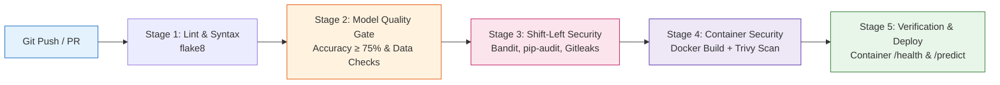

# SecureML-CI: Automated Secure ML Deployment Pipeline

[](https://github.com)
[](https://github.com)
[](https://github.com)
[](https://fastapi.tiangolo.com)

**Adaptive Software Engineering | Review-2**

SecureML-CI is an automated DevSecMLOps pipeline that bridges the gap between machine learning model training, quality assurance, multi-layered security auditing, and automated containerized deployment.

---

## 1. Problem Statement & Motivation
* **Manual Releases:** Machine learning models are traditionally trained inside isolated Jupyter notebooks and manually copied to production servers, resulting in non-reproducible, slow deployments.
* **Security Blindspots:** Traditional CI/CD ignores ML-specific risks: vulnerable dependencies, leaked credentials, code injections, and unhardened container images.
* **No Quality Enforcement:** Degraded or undertrained models can accidentally reach production without strict accuracy threshold gates.

---

## 2. Architecture & Pipeline Workflow

Every `git push` or `pull_request` triggers a multi-stage, fail-closed GitHub Actions workflow:



> **The "Fail-Closed" Principle:** If **any** stage fails (e.g. accuracy drops below 75%, an API key is detected in code, or a critical vulnerability is found), the pipeline terminates immediately and blocks deployment.

---

## 3. Core Modules & Technologies

| Module | Purpose | Technology |
| :--- | :--- | :--- |
| **ML Training** | Trains classification models on customer churn / tabular data. | `scikit-learn`, `pandas`, `joblib` |
| **Validation Gate** | Enforces data schema integrity and minimum accuracy ($\ge 80\%$) & F1 ($\ge 70\%$). | `src/validate.py`, `pytest` |
| **Security Auditing** | Shift-left security for code, packages, secrets, and container image. | `Bandit`, `pip-audit`, `Gitleaks`, `Trivy` |
| **Serving & API** | Production REST API with schema validation & health checks. | `FastAPI`, `Uvicorn`, `Pydantic` |
| **Packaging** | Hardened container running under an unprivileged non-root user. | `Docker (python:3.11-slim)` |
| **CI/CD** | Automated orchestration of all stages on commit. | `GitHub Actions` |

---

## 4. Project Directory Layout

```text
SecureML-CI/
├── .github/
│   └── workflows/
│       └── secureml-ci.yml    # 4-Stage DevSecMLOps GitHub Actions pipeline
├── data/
│   ├── customer_churn.csv     # Bank customer churn dataset (10,000 records)
│   └── heart_disease.csv      # Clinical benchmark dataset
├── models/
│   ├── model.joblib           # Trained model artifact
│   └── metrics.json           # Evaluation metrics (Accuracy, F1, Precision)
├── src/
│   ├── __init__.py
│   ├── app.py                 # FastAPI inference service
│   ├── train.py               # Model training script
│   └── validate.py            # Quality gate assertion script
├── tests/
│   ├── __init__.py
│   ├── test_api.py            # API integration & validation tests
│   └── test_model.py          # Data validation & model threshold tests
├── .flake8                    # Flake8 linter configuration
├── .gitignore                 # Git ignore rules
├── .gitleaks.toml             # Secret scanner configuration
├── Dockerfile                 # Production hardened container
└── requirements.txt           # Pinned production & testing dependencies
```
│   ├── validate.py            # Quality gate validation script
│   └── app.py                 # FastAPI prediction web service
├── tests/
│   ├── test_model.py          # Quality gate & model tests
│   └── test_api.py            # FastAPI endpoint tests
├── .flake8                    # Flake8 linter rules
├── .gitignore                 # Git ignore file
├── .gitleaks.toml             # Secret scanner rules
├── Dockerfile                 # Hardened, non-root Dockerfile
├── requirements.txt           # Production & Dev dependencies
└── README.md                  # Project documentation
```

---

## 5. Running Locally

### Step 1: Clone and Set Up Virtual Environment
```bash
git clone <your-repo-url>
cd SecureML-CI

python -m venv venv
# On Windows:
.\venv\Scripts\activate
# On Linux/macOS:
source venv/bin/activate

pip install -r requirements.txt
```

### Step 2: Train and Run Quality Gate
```bash
# Train the model
python src/train.py

# Run Data & Model Quality Gates (fails if accuracy < 75%)
python src/validate.py --min-accuracy 0.75 --min-f1 0.70
```

### Step 3: Run Security Audits Locally
```bash
# 1. Code SAST Scan
bandit -r src/ -ll -ii

# 2. Dependency Vulnerability Audit
pip-audit -r requirements.txt
```

### Step 4: Run the API
```bash
uvicorn src.app:app --host 0.0.0.0 --port 8000 --reload
```
Open **`http://localhost:8000/docs`** in your browser to interact with the API using Swagger UI.

---

## 6. Docker Container Deployment

### Build and Run with Docker
```bash
# Build the hardened image
docker build -t secureml-ci-app:latest .

# Run container
docker run -d -p 8000:8000 --name ml_service secureml-ci-app:latest

# Check health endpoint
curl http://localhost:8000/health
```

### Send a Sample Prediction Request
```bash
curl -X POST http://localhost:8000/predict \
  -H "Content-Type: application/json" \
  -d '{
    "age": 58,
    "sex": 1,
    "resting_bp": 130.0,
    "cholesterol": 240.0,
    "fasting_bs": 0,
    "max_heart_rate": 160.0,
    "exercise_angina": 0,
    "oldpeak": 1.2
  }'
```

**Response:**
```json
{
  "prediction": 1,
  "probability": 0.8842,
  "risk_level": "High Risk",
  "model_version": "1.0.0"
}
```

---

## 7. How to Demonstrate in Review-2
1. **Happy Path Demonstration:** Show a successful push to `main` with all 5 stages in GitHub Actions passing green.
2. **Quality Gate Failure:** Lower the accuracy threshold in `validate.py` or feed corrupted data to prove the pipeline stops deployment.
3. **Security Gate Failure:** Add a dummy API token or vulnerable package to demonstrate automated detection by Gitleaks / pip-audit.
